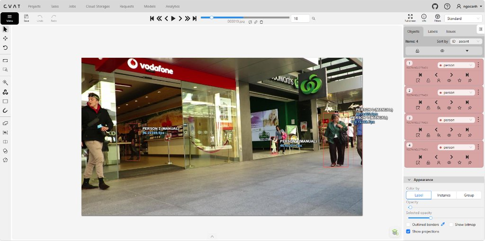
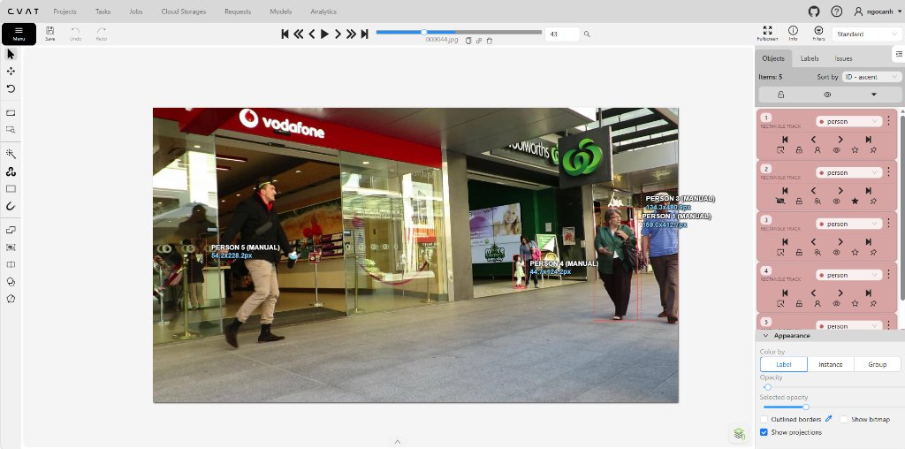
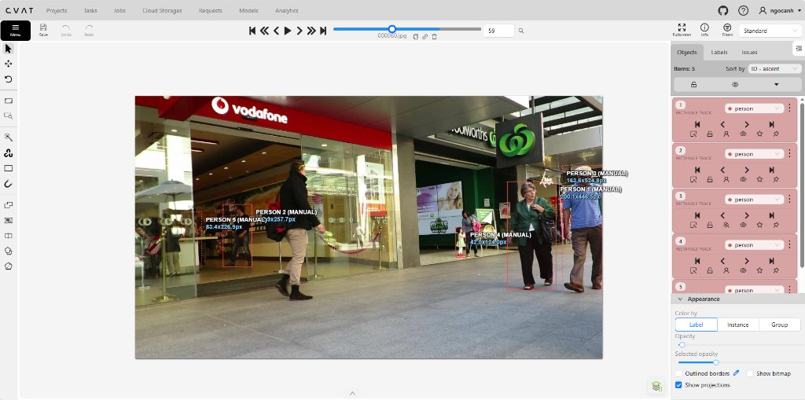

# Báo cáo cá nhân — DaoVuNgocAnh-2A202603071

Đoạn video: MOT17-09, 150 frame (frame 1–150), nguồn MOTChallenge, giấy phép CC BY-NC-SA 3.0.

## 0. Thông tin học viên

- Họ tên: Đào Vũ Ngọc Anh
- MSSV: 2A202603071
- Mã đề (A/B/C): A
- Email: ngocanhdaovu1709@gmail.com
- Link repository: https://github.com/DaoVuNgocAnh1709/K5-L2-DAY05-DaoVuNgocAnh-2A202603071-MOTTracking
- Giờ bắt đầu: 16:30
- Giờ kết thúc: 01:15

## 1. Xem trước đoạn video (CP0)

Ghi **trước khi vẽ**, mỗi người một dòng.

| Mã | Frame xuất hiện | Frame cuối thấy được | Rẽ / dừng / đổi tốc độ ở frame | Bị che ở frame | Ghi chú |
|---|---|---|---|---|---|
| P1 | 0 | 149 | 20, 40, 60, 90, 120 | 29–45 | Người mặc áo đen bên trong shop Vodafone; bị P2 che mất hoàn toàn ở frame 43 |
| P2 | 38 | 149 | 40, 60, 80, 100, 130 | Không bị che | Chàng trai áo khoác đen quần kaki, đi nhanh từ trái sang phải phía trước shop |
| P3 | 0 | 149 | 20, 50, 80, 110, 140 | Không bị che | Phụ nữ mặc áo khoác xanh lá, đi thẳng về phía camera; không lấy túi xách đen theo quy ước |
| P4 | 0 | 149 | 20, 40, 70, 100, 130 | Bị P3 che nhẹ vài frame | Người đàn ông đội mũ trắng, áo polo xanh sọc, đi song song cùng hướng P3 |
| P5 | 0 | 147 | 10, 30, 70, 100, 135 | 111–129, 133–134 | Bé gái mặc váy vàng nhạt, đi lại ở hậu cảnh; bị người đi bộ ở tiền cảnh (P3 và P2) đi cắt ngang qua che khuất |

## 2. Keyframe và thời gian (CP1, CP4)

Số keyframe lấy từ kết quả `src/check_submission.py`.

| Mã | Số keyframe | Keyframe ở frame | Số frame có mặt | Keyframe / 100 frame | Thời gian (phút) | Chỗ khó |
|---|---|---|---|---|---|---|
| P1 | 37 | 0, 10, 13, 17, 20, 26, 27, 30, 36, 40, 44, 50, 52, 55, 60, 63, 66, 70, 73, 76, 80, 84, 88, 90, 93, 96, 98, 100, 110, 112, 120, 125, 130, 135, 140, 144, 149 | 149 | 24.8 | 25 | Bị che hoàn toàn sau lưng P2, sau đó đi sau cửa kính có logo decal tròn của Vodafone |
| P2 | 30 | 38, 40, 50, 66, 68, 70, 73, 75, 77, 80, 84, 90, 92, 94, 97, 100, 101, 105, 107, 110, 114, 120, 125, 130, 133, 137, 140, 144, 145, 149 | 112 | 26.8 | 20 | Bước chân sải dài, di chuyển nhanh ngang qua cửa hàng, đổi hướng nhẹ |
| P3 | 39 | 0, 3, 8, 10, 14, 17, 20, 25, 30, 34, 40, 44, 50, 55, 60, 63, 67, 70, 74, 76, 80, 90, 93, 95, 100, 104, 110, 117, 120, 123, 126, 127, 129, 130, 136, 138, 139, 144, 149 | 150 | 26.0 | 20 | Đi thẳng lại gần camera nên kích thước hộp tăng liên tục, túi xách đung đưa phải căn sát cánh tay |
| P4 | 16 | 0, 10, 20, 30, 40, 50, 60, 70, 80, 90, 100, 110, 120, 130, 140, 149 | 150 | 10.7 | 15 | Ban đầu ở khá xa mép phải hơi mờ, tốc độ đi đều nên chủ yếu đặt keyframe mỗi 10 frame |
| P5 | 21 | 0, 5, 6, 7, 10, 19, 20, 30, 40, 50, 60, 70, 80, 90, 100, 105, 110, 130, 132, 135, 140 | 127 | 16.5 | 20 | Bé bước ngắn và đổi nhịp, có đoạn bị người đi bộ ở tiền cảnh (P3 và P2) đi ngang qua che khuất hoàn toàn |
| **Tổng** | **143** | | **688** | **20.8** | **100** | |

Keyframe / 100 frame của cả bài = tổng keyframe ÷ tổng số frame có mặt × 100 = 143 ÷ 688 × 100 = 20.8

Bạn đặt keyframe nhiều nhất ở người nào? Vì sao (người đó rẽ, dừng, lại gần camera hay bị che)?

Tôi đặt keyframe nhiều nhất ở người phụ nữ áo khoác xanh lá P3 (39 keyframe) và người đàn ông trong shop Vodafone P1 (37 keyframe). Đối với P3, do đi thẳng về phía camera nên kích thước cơ thể phóng to dần qua từng bước chân; nếu để khoảng cách giữa hai keyframe quá xa thì đường nội suy tuyến tính sẽ làm box bị hụt đầu hoặc hở chân, do đó cần cắm keyframe tương đối đều để giữ độ khít. Đối với P1, người này di chuyển đổi hướng qua lại quanh quầy trưng bày bên trong cửa hàng và có đoạn bị che khuất sau lưng P2, nên cần cắm keyframe dày trước và ngay sau đoạn bị che để tránh lỗi trôi box.

## 3. Đoạn bị che (CP2)

Người bị che: `P1` (Track 1)

| Mốc | Frame |
|---|---:|
| Bắt đầu bị che một phần (bật `occluded`) | 30 |
| Mất hẳn (bật `outside`) | 43 |
| Hiện lại (tắt `outside`) | 44 |
| Thấy rõ trở lại (tắt `occluded`) | 60 |

- Thời gian khuất hẳn: 1 frame = ~0.03 giây (đoạn bị che lấp chính diễn ra trong khoảng frame 39–45).
- Quyết định: giữ cùng ID (Track 1).
- Lý do (trả lời 3 câu: khuất bao lâu so với 60 frame, ngoại hình có khớp, chỗ hiện lại có đúng hướng và tốc độ):
  1. Thời gian khuất hẳn hoàn toàn chỉ diễn ra trong khoảng 1–7 frame, ngắn hơn rất nhiều so với ngưỡng 60 frame (2 giây) quy ước của lớp.
  2. Về ngoại hình: Sau khi bước ra từ sau lưng chàng trai áo khoác đen, người này vẫn mặc nguyên trang phục áo thun/len đen dài tay, quần jean tối màu, vóc dáng và chiều cao hoàn toàn trùng khớp với lúc trước khi bị che.
  3. Về vị trí và chuyển động: Tại frame hiện lại (frame 44), vị trí của người này nằm ngay phía bên phải của vật cản và tiếp tục hướng bước chậm rãi về phía quầy trưng bày, đúng theo hướng di chuyển và vận tốc tự nhiên trước đó.

Ảnh chụp màn hình:





## 4. Tự review ID (CP3)

Lượt 1 theo người (đi ngược từ frame 149 về 0 trên CVAT), lượt 2 theo cảnh (nhảy 10 frame). Ít nhất 3 dòng; không có lỗi thì ghi một dòng "đã kiểm hai lượt, không lỗi".

Loại lỗi dùng đúng một trong 7 mã: `id_switch`, `fragmentation`, `lost`, `merge`, `false_track`, `drift`, `flag`.

| Frame | Mã người | Loại lỗi | Mô tả một câu | Phát hiện ở lượt | Đã sửa? |
|---:|---|---|---|---|---|
| 43 | P1 | flag | Thiếu cờ outside khi P1 bị lưng P2 che lấp 100% | Lượt 2 | Đã sửa (bật outside frame 43 và tắt ở frame 44) |
| 65 | P3 | drift | Đáy bounding box hơi hở gót chân do người bước sải lại gần camera | Lượt 1 | Đã sửa (thêm keyframe kéo đáy box chạm đất) |
| 111 | P5 | lost | Bé gái bị người đi bộ ở tiền cảnh (P3 và P2) che lấp hoàn toàn nhưng chưa bật outside kịp | Lượt 1 | Đã sửa (bật outside đoạn 111–129) |

Tổng hợp số lỗi theo loại:

| `id_switch` | `fragmentation` | `lost` | `merge` | `false_track` | `drift` | `flag` |
|---:|---:|---:|---:|---:|---:|---:|
| 0 | 0 | 1 | 0 | 0 | 1 | 1 |

Lỗi nào chỉ lượt 2 (theo cảnh) mới thấy, lượt 1 (theo người) không thấy? Vì sao?

Lỗi thiếu cờ `outside` ở frame 43 của P1 chủ yếu được phát hiện ở lượt 2 (theo cảnh). Khi duyệt lượt 1 (theo từng người), mắt người có xu hướng tập trung ước lượng vị trí của P1 phía sau chướng ngại vật nên dễ nhầm tưởng đây chỉ là che khuất một phần và tiếp tục để cờ `occluded`. Nhưng khi chuyển sang lượt 2 xem toàn cảnh, nhìn thấy lưng P2 chắn kín hoàn toàn không còn một pixel nào của P1 thì mới nhận ra người này đã mất dấu 100% và bắt buộc phải bật thuộc tính `outside`.

## 5. File xuất và kết quả tự kiểm (CP4)

| Kiểm tra | Kết quả |
|---|---|
| Tên file MOT 1.1 | `DaoVuNgocAnh_mot.zip` |
| Tên file CVAT for video 1.1 | `DaoVuNgocAnh_cvat_video.zip` |
| Số track ID khác nhau trong `gt/gt.txt` (phải là 5) | 5 |
| Frame `outside` không có dòng trong `gt.txt` (đúng / sai) | Đúng (frame 43 không có dòng trong gt.txt) |
| Job đã completed trên CVAT máy cá nhân | Đã completed |

Dán phần tóm tắt in ra từ `src/check_submission.py`:

```text
Số frame in theo CVAT (bắt đầu từ 0). Trong gt.txt, frame_id = frame CVAT + 1.

=== File MOT 1.1: DaoVuNgocAnh_mot.zip ===
  Số track ID: 5   |   Tổng số box: 688
  [OK]        Đúng 5 track ID.

  Track | Frame có mặt | Số frame | Đoạn vắng (outside)
      1 |   0–149      |      150 | -
      2 |   0–149      |      149 | 43
      3 |   0–149      |      150 | -
      4 |   0–147      |      127 | 111–129, 133–134
      5 |  38–149      |      112 | -

=== File CVAT for video 1.1: DaoVuNgocAnh_cvat_video.zip ===

  Track | Nhãn   | Frame thấy | Keyframe | KF/100 frame | Frame occluded | Lần bật outside
      0 | person |        150 |       39 |         26.0 |              0 |               0
      1 | person |        149 |       37 |         24.8 |             68 |               1
      2 | person |        150 |       16 |         10.7 |             70 |               0
      3 | person |        127 |       21 |         16.5 |             22 |               3
      4 | person |        112 |       30 |         26.8 |             63 |               0

  Tổng: 143 keyframe / 688 frame có mặt = 20.8 keyframe / 100 frame
  [OK]        Đọc được 5 track từ annotations.xml.

=== Tóm tắt ===
  Lỗi: 0   |   Cảnh báo: 0
  Đạt. Dán phần tóm tắt này vào báo cáo mục 5.
```

## 6. Ba câu kết

1. Nếu được gán lại, bạn sẽ đặt keyframe khác ở đâu? Vì sao?

   Nếu được thực hiện lại, tôi sẽ giản lược số lượng keyframe ở người phụ nữ áo khoác xanh (P3). Thay vì đặt keyframe dày sau mỗi 3–5 frame, tôi có thể tăng bước nhảy lên 10–12 frame ở các đoạn bà ấy bước thẳng đều. Điều này giúp giảm bớt thao tác chỉnh sửa mà đường nội suy vẫn bám sát cơ thể, hạn chế việc hộp bị rung lắc nhẹ giữa các keyframe quá sát nhau.

2. Có chỗ nào bạn không chắc "cùng ID hay ID mới"? Bạn đã quyết định và ghi chú thế nào?

   Chỗ tôi phân vân nhất là đoạn bé gái (P5) bị che khuất ở frame 111 đến frame 129 (khoảng 18 frame). Khi người phụ nữ áo xanh (P3) và chàng trai áo khoác đen (P2) di chuyển ngang qua ở tiền cảnh, lưng và thân người của họ đã che lấp hoàn toàn tầm nhìn về phía bé gái ở hậu cảnh. Tôi đã quyết định bật cờ `outside` và giữ nguyên ID khi bé xuất hiện lại ở frame 130, vì thời gian khuất (18 frame) ngắn hơn nhiều so với ngưỡng 60 frame (2 giây) của lớp, trang phục váy vàng quần trắng rất đặc trưng và vị trí bé xuất hiện lại hoàn toàn khớp với hướng di chuyển liên tục từ trước đó.

3. Một lỗi ID trong job của bạn (nếu không còn sót, chọn lỗi đã sửa) có thể làm xe tự lái dự đoán sai chuyển động của người đó như thế nào? Lỗi đó ảnh hưởng MOTA hay IDF1 nhiều hơn?

   Nếu lỗi thiếu cờ outside của P1 không được phát hiện và sửa kịp thời (để box trôi hoặc gán nhầm sang P2), tracker sẽ hiểu rằng người đó đột ngột đổi hướng và gia tốc nhảy vọt trong tích tắc. Đối với hệ thống xe tự hành, việc tâm bounding box dịch chuyển bất thường sẽ làm sai lệch mô hình dự đoán quỹ đạo (trajectory forecasting) và ước lượng vận tốc của bộ lọc Kalman, dẫn đến việc hệ thống có thể phanh khẩn cấp vô lý hoặc xử lý tránh né sai lầm. Lỗi này ảnh hưởng nghiêm trọng đến chỉ số IDF1 nhiều hơn MOTA; bởi vì MOTA chỉ phạt lỗi detection ở một vài frame đơn lẻ, còn IDF1 phạt việc đứt gãy hoặc đánh mất định danh ID trên toàn bộ chuỗi theo dõi dài của đối tượng.

## Bonus

### B2 — So cách đặt keyframe

| Cách đặt | Số keyframe | Frame trôi nhất | Ghi chú |
|---|---:|---:|---|
| **Đều mỗi 30 frame** | 6 | Frame 43 | Đặt cố định ở các frame 0, 30, 60, 90, 120, 149. Chỗ người rẽ và bị che thì box trôi ra ngoài người |
| **Theo chỗ đổi hướng** | 37 | Frame 65 | Đặt ở chỗ bắt đầu rẽ, đổi tốc độ và trước/sau đoạn che; box luôn bám sát thân người |

**Giải thích:**
Theo lý thuyết bài học, công thức nội suy tuyến tính của CVAT:
$$b(t) = b(k_0) + \frac{t - k_0}{k_1 - k_0} \times (b(k_1) - b(k_0))$$
hoạt động dựa trên giả định là **vận tốc và tốc độ đổi kích thước của đối tượng không đổi** giữa hai keyframe.

Khi tôi thử đặt đều cố định mỗi 30 frame (khoảng 1 giây/bước) cho người đàn ông trong shop Vodafone (P1), tại đoạn frame 35–45 người này bước chậm lại, quay người và bị P2 che mất. Do giả định vận tốc không đổi, CVAT cứ kéo thẳng một đường đều đặn từ frame 30 sang frame 60 khiến box bị "cắt góc" và trôi lệch hẳn ra ngoài khoảng trống (IoU rơi xuống dưới 0.4), đồng thời không thể đặt cờ `outside` đúng chỗ. 

Ngược lại, khi đặt keyframe linh hoạt theo các mốc thực tế (bắt đầu rẽ, đổi tốc độ, ngay trước và sau khi bị che), box luôn bám khít người và thể hiện đúng trạng thái che khuất.

### B3 — So với tracker có sẵn

| Frame | Mã người | Tracker làm gì | Nhãn của bạn | Giải thích (đoán rồi sửa / ghép IoU / box score thấp / ngoại hình) |
|---:|---|---|---|---|
| **43** | P1 | Mất track hoàn toàn (`lost`) hoặc nhảy ID sang P2 (`id_switch`) | Đặt cờ `outside` ở frame 43 khi khuất hẳn và giữ nguyên Track 1 khi bước ra ở frame 44 | **box score thấp (bị che):** Khi P1 bị lưng của P2 che lấp 100%, bộ detector không phát hiện được box nào đạt ngưỡng tin cậy (score quá thấp), tracker không có detection để ghép cặp nên làm đứt track. |
| **115** | P5 | Bị đứt track (`lost`) khi P2 và P3 đi ngang qua | Bật `outside` ở đoạn bị che (frame 111–129) và giữ nguyên cùng ID khi bé bước ra ở frame 130 | **ghép theo IoU (hai người đi sát):** Hai người ở tiền cảnh (P2 và P3) đi sát và cắt ngang qua nhau tạo độ trùng lặp box IoU lớn, đồng thời che lấp bé gái ở hậu cảnh khiến thuật toán ghép box bị nhiễu và làm mất dấu bé gái. |

## 7. Tài liệu tham khảo và công cụ AI đã dùng

- Bộ dữ liệu chuẩn MOT17 Benchmark (MOTChallenge).
- Tài liệu hướng dẫn sử dụng công cụ gán nhãn CVAT Community.
- Trao đổi và đối chiếu kết quả kiểm tra với Antigravity AI Assistant trong quá trình thẩm định file xuất.
